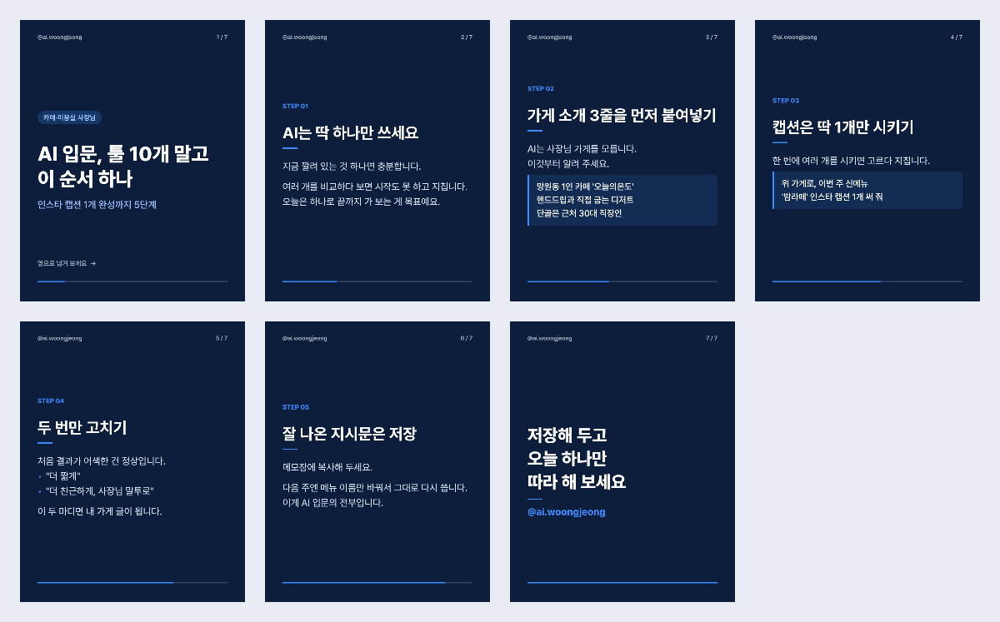

# carousel-maker — 원고 1개로 인스타 캐러셀 완성

텍스트 원고 파일 1개를 넣으면 **인스타그램 캐러셀 이미지(1080×1350 PNG) 세트 + 캡션(해시태그 포함)**을 한 번에 만듭니다.
인스타 계정 `@ai.woongjeong`(소상공인 대상 AI 활용 팁)을 주 2~3회 발행하려고 만든 도구입니다.



## 설치 (처음 한 번)

1. [Node.js](https://nodejs.org) 18 이상 설치 (개발·테스트는 v24)
2. 이 폴더에서:

```bash
npm install
```

## 실행

**방법 1 — 끌어다 놓기 (Windows)**: 원고 파일(`.md`)을 `make.bat` 아이콘 위에 끌어다 놓으면, 성공 시 결과 폴더가 열립니다.

**방법 2 — 명령어**

```bash
node make.mjs examples/01-ai-intro-order.md
```

결과는 `out/<원고 이름>/`에 생깁니다.

| 파일 | 내용 |
|:--|:--|
| `01.png` … `NN.png` | 업로드 순서대로 된 슬라이드 (표지 → 단계 → CTA) |
| `caption.txt` | 후킹 1줄 → 핵심 → CTA 1줄 → 해시태그 (그대로 붙여넣기) |
| `preview.png` | 전 장을 한눈에 보는 썸네일 |

## 원고 형식

```text
제목: AI 입문, 툴 10개 말고 이 순서 하나      ← 필수 · 표지 큰 글씨
대상: 카페·미용실 사장님                        ← 필수 · 표지 위 라벨
부제: 인스타 캡션 1개 완성까지 5단계           ← 선택
CTA: 저장                                       ← 필수 · 저장 / 팔로우 / 공유 / 댓글
후킹: 캡션 첫 줄 (없으면 제목 사용)            ← 선택
핵심: 캡션 핵심 줄 (여러 번 가능, 없으면 단계 제목 목록)
태그: #AI입문 #인스타캡션                       ← 선택 · 기본 태그에 추가
---
단계 제목 (블록 첫 줄)
본문 줄
- 글머리 줄
> 예시 박스 줄 (연속된 > 줄은 한 박스)
---
다음 단계 …
```

- `---`로 슬라이드를 나눕니다. 빈 줄은 문단 간격입니다. `//`로 시작하는 줄은 메모(무시)입니다.
- 색·핸들·기본 해시태그·CTA 문구·금지어·한도는 `brand.json`에서 바꿉니다.

## 검사 규칙 — 하나라도 걸리면 이미지를 만들지 않고 이유를 알려 줍니다

| 검사 | 기준 | 오류 예 |
|:--|:--|:--|
| 필수 항목 | 제목·대상·CTA | `[머리말] 필수 항목 "대상:"이 없습니다` |
| CTA 종류 | 저장/팔로우/공유/댓글 | `CTA "좋아요"는 쓸 수 없습니다` |
| 빈 슬라이드 | `---` 연속 | `[3번 슬라이드 · 원고 8줄] 내용이 비어 있습니다` |
| 슬라이드 수 | 본문 2~8장 | `본문 슬라이드는 2~8장이어야 합니다` |
| 제목 줄 수 | 단계 제목 3줄, 표지 4줄 이하 | `제목이 4줄입니다 (최대 3줄)` |
| 글자 넘침 | 실제 글꼴로 폭·높이 측정 | `내용이 아래로 550px 넘칩니다 → 본문을 약 8줄 줄이세요` |
| 이모지 | 이미지 글꼴에 없음 | `이모지는 이미지에서 깨집니다` |
| 금지어 | 효과 보장·절대 표현 | `금지어 "무조건"` |
| 해시태그 | `#` 시작·공백 없음, 30개 이하 | `"매출올리기" — 해시태그는 #으로 시작…` |
| 캡션 길이 | 2,200자 이하 | `[캡션] 2,350자 — 인스타 한도…` |

종료 코드: `0` 성공 · `1` 원고 오류(파일 생성 안 함) · `2` 파일 없음/사용법 오류

## 승인 목록

만든 결과물을 승인하고 발행을 기록하는 화면입니다. 사용법은 [docs/QUEUE.md](docs/QUEUE.md)를 보세요.

## 테스트

```bash
npm test
```

정상 원고 1건 + 예외 원고 3건을 실제로 실행해 확인합니다 (PNG 크기 1080×1350, 장수, 캡션 구성, 오류 메시지, 오류 시 파일 미생성). 실행 기록은 `docs/evidence/`에 있습니다.

## 한계

- 텍스트 슬라이드 전용입니다. 사진·화면 캡처를 넣는 슬라이드는 아직 못 만듭니다.
- 디자인 템플릿은 1종입니다 (표지 / 단계 / CTA).
- 줄바꿈은 띄어쓰기 단위라 가끔 어색한 위치에서 끊길 수 있습니다. 원고에서 줄을 직접 나누면 됩니다.
- 금지어는 단순 포함 검사라 `최고급`처럼 무해한 단어도 `최고`로 걸립니다.
- 인스타 업로드는 하지 않습니다 (업로드는 사람이 확인 후 직접).

## 라이선스

코드 MIT. 글꼴 [Pretendard](https://github.com/orioncactus/pretendard)는 SIL Open Font License 1.1 (npm 패키지로 설치).
